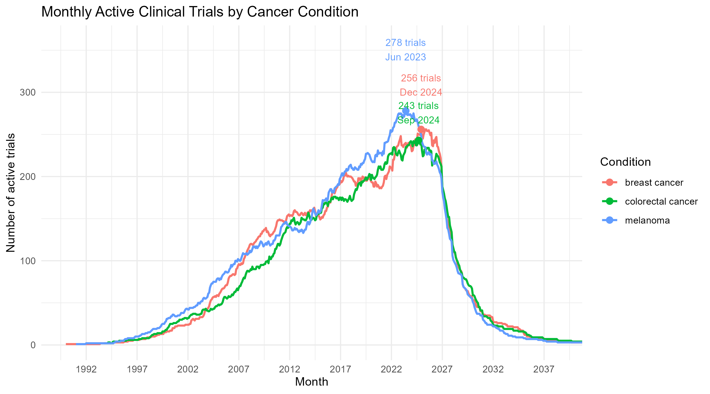
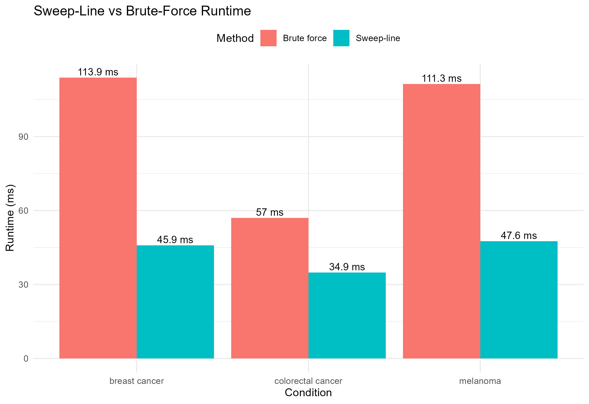

<div align="center">

# Clinical Trial Overlap Engine

**A Python data engine that turns ClinicalTrials.gov records into monthly trial-activity timelines and measures overlapping trials with a tested sweep-line algorithm.**

[](https://www.python.org/)
[](https://duckdb.org/)
[](https://www.r-project.org/)
[](#-testing)
[](https://clinicaltrials.gov/data-api/api)

</div>

## Overview

At any point in time, hundreds of clinical trials may be running simultaneously. The Clinical Trial Overlap Engine, or **ctoverlap** for short, measures this activity by converting each eligible trial into a defined start–end interval and calculating how many are active in each month.

Version 1.0 currently supports three conditions: **colorectal cancer, melanoma, and breast cancer**. I intend for future versions to support user-defined searches across a much broader range of conditions. The pipeline starts by downloading the public ClinicalTrials.gov records and filtering inconsistent dates and metadata. Then it applies eligibility rules and organizes the data in DuckDB. 

The data is then generated into monthly trial-density timelines for conditions, phases, countries, and intervention types. This is done through two methods: a sweep-line algorithm and a brute-force method. The sweep-line performs the analysis efficiently and the brute-force method verifies that the results are correct. This also gives us a benchmark to compare the performance advantage of a sweep-line algorithm.

The result is a command-line pipeline that shows how clinical trial activity changed over time and where the largest overlaps occurred.

<div align="center">



</div>

## 📑 Table of contents

- [Results](#results)
- [Core capabilities](#️core-capabilities)
- [Project structure](#project-structure)
- [Installation](#installation)
- [Usage](#usage)
- [How it works](#how-it-works)
- [Generated outputs](#generated-outputs)
- [Testing](#testing)
- [Roadmap](#️roadmap)
- [Data source](#data-source)
- [Why I built this](#Why-I-built-this)
- [Contact](#contact)


## Results

> Results reflect the retained extraction. Counts may change when ClinicalTrials.gov records are downloaded again. Particularly for ongoing trials whose temporary endpoint is the extraction date.


### Peak monthly trial activity

| Condition | Eligible trials | Peak active trials | Peak month |
|---|---:|---:|---|
| Melanoma | 980 | 278 | June 2023 |
| Breast cancer | 986 | 256 | December 2024 |
| Colorectal cancer | 992 | 243 | September 2024 |

“Eligible trials” is not the total number of API records downloaded and means records with a usable start date and a usable or derived end date.

### Sweep-line vs. brute force

| Condition | Sweep-line | Brute force | Speedup | Outputs matched |
|---|---:|---:|---:|:---:|
| Colorectal cancer | 34.9 ms | 57.0 ms | **1.63×** | Yes |
| Melanoma | 47.6 ms | 111.3 ms | **2.34×** | Yes |
| Breast cancer | 45.9 ms | 113.9 ms | **2.48×** | Yes |

Both methods produced identical monthly counts for all three condition queries, so the benchmark acts as a correctness check.



## Core capabilities

- **Reproducible extraction:** saves raw API responses and extraction metadata.
- **Explicit cleaning rules:** normalizes dates, phases, statuses, countries, sponsors, and interventions.
- **Interval analysis:** converts eligible trials into monthly activity timelines.
- **Analytical storage:** loads normalized trial entities and results into DuckDB.
- **Correctness validation:** compares complete sweep-line and brute-force outputs.
- **Re-runnable CLI:** exposes every pipeline stage through `ctoverlap`.

## Project structure

<details>
<summary><strong>View repository structure</strong></summary>

```text
.
├── README.md
├── pyproject.toml
├── data/
│   ├── raw/                    # Downloaded JSON and extraction metadata
│   ├── processed/              # Cleaned and excluded trial CSV files
│   └── database/               # Local DuckDB database
├── outputs/
│   ├── tables/                 # Monthly-density and benchmark CSV files
│   ├── figures/                # R-generated plots
│   └── report/                 # R-generated summary CSV files
├── reports/
│   └── final_report.R          # Reporting and visualization script
├── src/ctoverlap/
│   ├── __init__.py             # Package marker
│   ├── cli.py                  # Command routing
│   ├── download.py             # API download and extraction metadata
│   ├── inspect_fields.py       # Raw JSON field inspection
│   ├── clean.py                # Field extraction and cleaned outputs
│   ├── dates.py                # Date parsing
│   ├── phases.py               # Phase normalization
│   ├── intervals.py            # Active-trial interval rules
│   ├── sweep_line.py           # Main overlap algorithm
│   ├── brute_force.py          # Correctness baseline
│   ├── database.py             # DuckDB table construction
│   ├── analyze.py              # Strata generation and monthly analysis
│   ├── benchmark.py            # Runtime and output comparison
│   ├── export.py               # Monthly-density CSV exports
│   └── report.py               # Python-to-R report runner
└── tests/
    ├── test_dates.py
    ├── test_phases.py
    ├── test_intervals.py
    └── test_benchmark.py

```
</details>

The contents of `data/` and `outputs/tables/` are generated automatically when the pipeline is run. These files are not tracked by Git with the exception of a small set of figures and summary CSVs included so the project results can be seen immediately without rerunning the full workflow. 

## Installation

### Requirements

- Python 3.10 or newer
- `pip`
- R, only for `ctoverlap report`

Clone the repository and create a virtual environment:

```bash
git clone https://github.com/AmiraliAhm4di/trial-sweep.git
cd trial-sweep

python -m venv .venv
```

Activate it:

```bash
# Windows PowerShell
.venv\Scripts\Activate.ps1

# Windows Command Prompt
.venv\Scripts\activate.bat

# macOS / Linux
source .venv/bin/activate
```

Install the project with its development dependencies:

```bash
python -m pip install --upgrade pip
python -m pip install -e ".[dev]"
```

The development extra installs `pytest`. Users who only need the pipeline can instead run:

```bash
python -m pip install -e .
```

### Optional R reporting layer

Install R, make sure `Rscript` is available on your system `PATH`, and install the required packages:

```bash
Rscript -e "install.packages(c('dplyr','ggplot2','here','readr'), repos='https://cloud.r-project.org')"
```

Verify that Python installed the CLI and that R is visible:

```bash
ctoverlap --help
Rscript --version
```

Everything except `ctoverlap report` can run without R.

## Usage

Run everything from the repo root. The download, clean, and inspect-fields commands currently use repository-relative data paths. I did not design them to run from arbitrary working directories.

### Full workflow

```bash
ctoverlap download
ctoverlap clean
ctoverlap build-db
ctoverlap analyze
ctoverlap benchmark
ctoverlap export
ctoverlap report
python -m pytest
```

The order matters because each stage consumes files created by the previous stages:

1. `download` creates the raw JSON and extraction metadata.
2. `clean` creates the cleaned and excluded CSV files.
3. `build-db` creates and loads the DuckDB database.
4. `analyze` fills the monthly-density table.
5. `benchmark` compares both algorithms and exports its results.
6. `export` writes the four monthly-density CSV files.
7. `report` reads the exported CSV files and produces figures and summary tables.

I made these stages separate on purpose so one part can be rerun or inspected without repeating the entire pipeline.

### Download or inspect one condition

```bash
ctoverlap download melanoma
ctoverlap download "breast cancer"
ctoverlap inspect-fields melanoma
```

Leaving the condition off `ctoverlap download` downloads all three supported condition queries. `inspect-fields` requires one condition and prints selected fields from the first three downloaded studies.

## How it works

### Extraction

The downloader calls the ClinicalTrials.gov API v2 and writes:

```text
data/raw/<condition>_raw.json
data/raw/<condition>_metadata.json
```

The metadata records the original condition query, extraction timestamp, number of downloaded records, API endpoint, and project version. The extraction date is part of the analysis logic because it becomes the temporary end date for ongoing trials that have no usable completion date.

Running `download` overwrites the raw file for that condition. Metadata saves the timestamp and query but Version 1.0 doesn't keep historical backups.

### Phase normalization

Phase values on ClinicalTrials.gov show up missing, duplicated, or combined (like "Phase 1, Phase 2"), so I had to decide up front how to bucket them. Each trial ends up in exactly one bucket:

- Early Phase 1
- Phase 1
- Phase 1/2
- Phase 2
- Phase 2/3
- Phase 3
- Phase 4
- Unspecified / Not Applicable

I decided a Phase 1/2 trial should count as its own bucket rather than double counting it in both Phase 1 and Phase 2. This preserves one analytical phase assignment per trial and prevents combined-phase studies from being counted twice. Unspecified trials still count toward the condition-level totals, but I dropped them from the phase-comparison figure since they don't belong on a phase axis.

### DuckDB design

I chose DuckDB because it provides a fast, lightweight database for joining, grouping, and exporting the project’s local analytical data. I loaded the cleaned data into one wide trials table, then split out conditions, countries, and interventions into their own tables since a single trial can list more than one of each; keeping them in the wide table would've meant duplicate rows or a messy delimited string.

```text
trials
excluded_trials
trial_conditions
trial_countries
trial_interventions
monthly_density
benchmark_results
```

### Sweep-line overlap algorithm

Each eligible trial interval becomes two events:

- `+1` during its starting month
- `-1` during the month after its ending month

The algorithm sorts these events chronologically and keeps a running count of active trials. Months without an event inherit the most recent count.

For `n` intervals and `m` months in the completed timeline, the sweep-line implementation runs in approximately **O(n log n + m)**: it creates at most two events per interval, sorts the event months, and then fills the monthly timeline.

I kept the brute-force method to verify that both methods had the same output and also have a performance baseline for comparison. The speedups listed here are modest since at this stage of the project it only analyzes around 1,000 trial intervals per condition. At this size, brute-force method is still practical but as the number of trials increases, sweep-line algorithm is expected to provide a larger performance advantage.

### Analysis strata

Monthly density is calculated for:

1. condition
2. condition + phase
3. condition + country
4. condition + intervention type

A stratum with fewer than five eligible trials does not receive a monthly density timeline. Instead, the database receives one flagged row with `group_analyzed = FALSE` and `skip_reason = "fewer_than_5_trials"`.

For analyzed groups, each monthly row carries:

```text
month
stratum_type
condition_query
phase_bucket
country
intervention_type
active_trial_count
started_trials
ended_trials
trial_count_total
group_analyzed
skip_reason
```

Country-level counts represent trials listing at least one location in that country.

### Python-to-R handoff

I wanted Python to handle the full data pipeline from downloading and cleaning the records to running the analysis and R to take those finished CSV files and turns them into the final figures and summary tables.

- a condition-level monthly density timeline
- a phase peak comparison
- top-country peak-density plots
- top-intervention-type peak-density plots
- a runtime comparison
- a peak-density summary CSV
- a benchmark summary CSV

The R layer does not currently render one combined HTML or PDF report document.

## Generated outputs

```text
data/raw/colorectal_cancer_raw.json
data/raw/colorectal_cancer_metadata.json
data/raw/melanoma_raw.json
data/raw/melanoma_metadata.json
data/raw/breast_cancer_raw.json
data/raw/breast_cancer_metadata.json

data/processed/cleaned_trials.csv
data/processed/excluded_trials.csv
data/database/clinical_trials.duckdb

outputs/tables/monthly_density_by_condition.csv
outputs/tables/monthly_density_by_condition_phase.csv
outputs/tables/monthly_density_by_condition_country.csv
outputs/tables/monthly_density_by_condition_intervention_type.csv
outputs/tables/benchmark_results.csv

outputs/figures/monthly_trial_density_by_condition.png
outputs/figures/peak_trial_density_by_phase.png
outputs/figures/top_countries_by_peak_trial_density.png
outputs/figures/top_intervention_types_by_peak_density.png
outputs/figures/sweep_line_runtime_comparison.png

outputs/report/peak_density_summary.csv
outputs/report/benchmark_summary.csv
```

## Testing

Run the test suite from the repository root:

```bash
python -m pytest
```

These tests are meant to cover parts of the project that are more error-prone. This includes data fallback rules and the phase bucketing. I also wrote tests to check trial intervals that start and end in the same month, ones without an end date and cases where a trial should be excluded. The last thing I tested was making sure the sweep-line algorithm and the brute-force version always produce the same monthly counts.

## Roadmap

- Pagination is capped at 1,000 studies per condition, which was fine for scoping v1.0 but I'd want to fix this before trusting the numbers on a bigger condition list.
- Making the condition list configurable instead of hardcoded so adding a new cancer type doesn't mean editing source files.
- A single rendered report instead of separate figures and CSVs.

## Data source

Trial metadata comes from the public [ClinicalTrials.gov API v2](https://clinicaltrials.gov/data-api/api). ClinicalTrials.gov supplies the source records but is not affiliated with this project. The cleaning rules, interval assumptions, database design, algorithms, and derived results are part of this implementation.

## Why I built this

My first project was a bioinformatics analysis in R on antigen-presentation machinery and CD8 T-cell coupling in colorectal cancer. As a first project it was a good opportunity to learn R and statistics when it comes to biological data but for my second project I wanted something Python heavy, more engineering than biology, with a real algorithmic core instead of just calling library functions on a dataset. I found ClinicalTrials.gov by accident while looking for something messy enough to be a genuine data engineering problem. The raw data ClinicalTrials provides has inconsistent date formats, missing completion dates, trials spanning multiple phases which makes it a good place to test my abilities.

Clinical trials naturally fit an interval-based problem because every trial has a start date and an end date. Since the goal was to measure how many trials were active at the same time, I modeled each trial as a time interval. That made the sweep-line algorithm a natural choice because it efficiently counts overlapping intervals without comparing every trial against every other trial.

I limited v1.0 to three conditions: **colorectal cancer, melanoma, breast cancer**. This was done to stop myself from trying to handle all of ClinicalTrials.gov and never finish. The project is built in Python (extraction, cleaning, the algorithm itself, CLI) with DuckDB for storage and R for the final plots.


## Contact

[@AmiraliAhm4di](https://github.com/AmiraliAhm4di)
